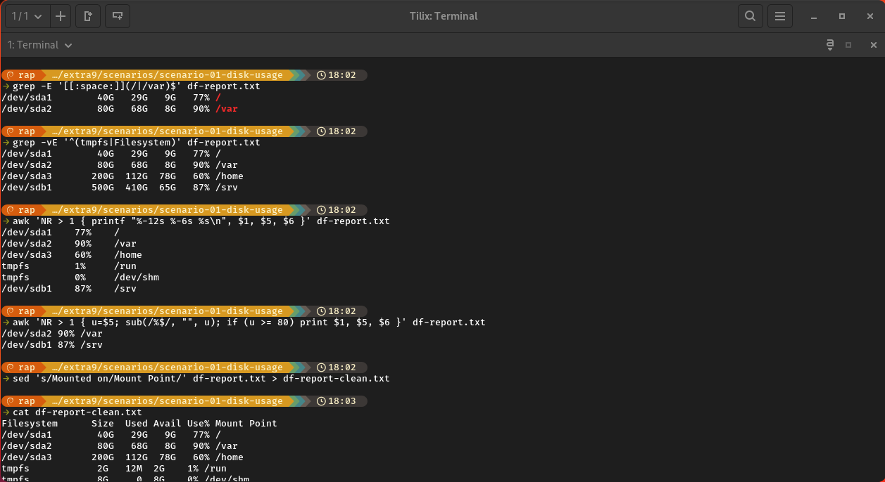
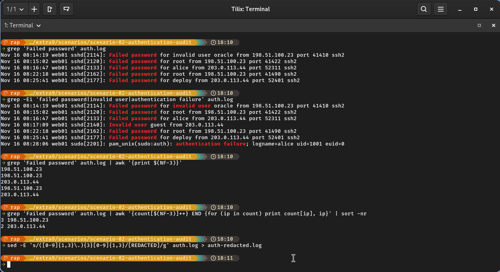
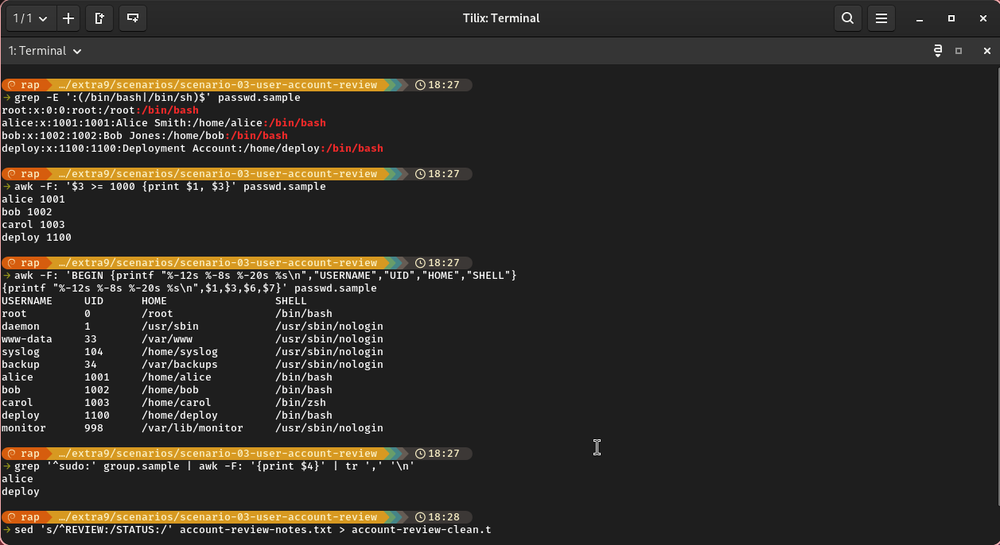
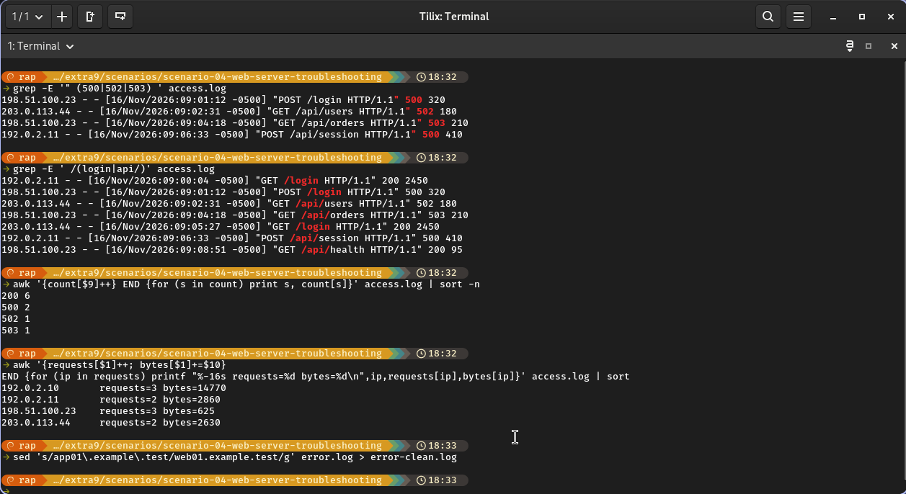
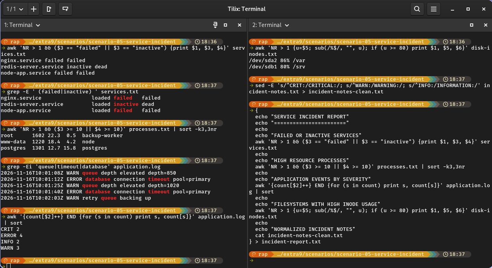

# {{page.title}}

- [{{page.title}}](#pagetitle)
  - [What will you learn](#what-will-you-learn)
  - [Required files](#required-files)
  - [Review](#review)
  - [GREP](#grep)
    - [Usage/Formula](#usageformula)
    - [Basic Examples](#basic-examples)
  - [AWK](#awk)
    - [Usage/Formula](#usageformula-1)
    - [Basic Examples](#basic-examples-1)
    - [Understanding AWK Fields and Variables](#understanding-awk-fields-and-variables)
  - [SED](#sed)
    - [Usage/Formula](#usageformula-2)
    - [Basic Examples](#basic-examples-2)
    - [Understanding SED Commands and Options](#understanding-sed-commands-and-options)
  - [Practice Time](#practice-time)
    - [Scenario 1](#scenario-1)
      - [Files](#files)
        - [Steps to complete](#steps-to-complete)
    - [Scenario 2](#scenario-2)
      - [Files](#files-1)
      - [Steps to complete](#steps-to-complete-1)
    - [Scenario 3](#scenario-3)
      - [Files](#files-2)
      - [Steps to complete](#steps-to-complete-2)
    - [Scenario 4](#scenario-4)
      - [Files](#files-3)
      - [Steps to complete](#steps-to-complete-3)
    - [Scenario 5](#scenario-5)
      - [Files](#files-4)
      - [Steps to complete](#steps-to-complete-4)
  - [What will you submit for extra credit](#what-will-you-submit-for-extra-credit)

## What will you learn

* Learn how to search for specific text patterns using `grep`
* Practice extracting and displaying specific columns of data using `awk`
* Learn how to modify and replace text using `sed`
* Develop the ability to process structured text files from the Linux terminal
* Practice combining multiple text-processing commands to solve real-world problems

## Required files
To download the required files, clone the following repository:

```bash
git clone https://github.com/linuxworkshop67/text-processing-files
```

## Review

## GREP
* The `grep` command is used to search for text that matches a pattern. `Grep` will search for a specified pattern line by line in a given file(s) or from the output of a command when using the pipe. You should use `grep` any time you need to read a file line by line in search of a given string. 
* **For example:**
  * John needs a list of all email addresses in a csv file that are gmail.com
    * `grep "gmail.com" users.csv`

### Usage/Formula
* With a file(s)
  * `grep` + `option` + `search string` + `file(s)`
* With the pipe
  * `command` + `|` + `grep` + `option`

### Basic Examples
* Get a list of all users in your machine that have the `/bin/bash` shell as the login shell
  * `grep '/bin/bash' /etc/passwd`
* Find out in which lines does the PATH variable gets exported in your bashrc file
  * `grep -n 'PATH' ~/.bashrc`
* Get a list of all the ip addresses found in the `ip addr` command's output
  * `ip addr | grep 'inet'`
> See more examples in the [presentation](https://rapurl.live/wwy)


## AWK
* The `awk` command is a powerful text-processing utility used to read, filter, extract, manipulate, and analyze structured text. `awk` processes a file line by line, treating each line as a record and dividing it into fields. By default, fields are separated by whitespace, but you can specify a different field separator. You should use `awk` whenever you need to extract specific columns, perform calculations, filter records based on conditions, or generate reports.
* **For example:**
  * John needs a list of usernames and their corresponding login shells from the `/etc/passwd` file.
    * `awk -F ':' '{print $1, $7}' /etc/passwd`

### Usage/Formula
* With a file(s)
  * `awk` + `option` + `'pattern { action }'` + `file(s)`
* With the pipe
  * `command` + `|` + `awk` + `option` + `'pattern { action }'`
* With a custom field separator
  * `awk` + `-F` + `separator` + `'pattern { action }'` + `file(s)`

### Basic Examples
* Get a list of all usernames from the `/etc/passwd` file.
  * `awk -F ':' '{print $1}' /etc/passwd`
* Display usernames and their login shells.
  * `awk -F ':' '{print $1, $7}' /etc/passwd`
* Display users with a UID greater than or equal to 1000.
  * `awk -F ':' '$3 >= 1000 {print $1, $3}' /etc/passwd`
* Calculate the average of a column of numbers.
  * `awk '{sum += $1} END {if (NR > 0) print sum / NR}' numbers.txt`

### Understanding AWK Fields and Variables
* `$0` - Represents the entire current record (line).
* `$1` - Represents the first field.
* `$2` - Represents the second field.
* `$NF` - Represents the last field.
* `NF` - Represents the number of fields in the current record.
* `NR` - Represents the total record number processed so far.
* `FS` - Represents the input field separator.
* `OFS` - Represents the output field separator.
* `BEGIN` - Executes commands before processing input.
* `END` - Executes commands after processing all input.

> See more examples in the [presentation](https://rapurl.live/wwy)

---

## SED
* The `sed` command (Stream Editor) is a text-processing utility used to search, replace, insert, delete, and transform text. `sed` reads input line by line, applies the specified editing instructions, and sends the modified output to standard output by default. Unlike a traditional text editor, `sed` does not require you to open a file interactively. You should use `sed` whenever you need to make automated changes to text files, replace strings, remove specific lines, or transform command output.
* **For example:**
  * John needs to replace every occurrence of the word `Linux` with `Debian` in a text file.
    * `sed 's/Linux/Debian/g' notes.txt`

### Usage/Formula
* With a file(s)
  * `sed` + `option` + `'command'` + `file(s)`
* With the pipe
  * `command` + `|` + `sed` + `option` + `'command'`
* Basic substitution
  * `sed 's/search/replace/flags' file.txt`

### Basic Examples
* Replace all occurrences of `Linux` with `Debian`.
  * `sed 's/Linux/Debian/g' file.txt`
* Delete all lines containing the word `ERROR`.
  * `sed '/ERROR/d' system.log`
* Display only the first five lines of a file.
  * `sed -n '1,5p' file.txt`
* Modify a file directly by replacing an old hostname with a new one.
  * `sed -i 's/old-server/new-server/g' config.txt`

### Understanding SED Commands and Options
* `s` - Performs a substitution.
* `d` - Deletes the matching line.
* `p` - Prints the selected line.
* `i` - Inserts text before a selected line.
* `a` - Appends text after a selected line.
* `c` - Replaces an entire selected line.
* `g` - Replaces all occurrences on a line instead of only the first.
* `-n` - Suppresses automatic printing; use it with `p` when selecting specific lines.
* `-i` - Modifies the original file directly (in-place editing).
* `-E` - Enables extended regular expressions.

> **Important:** `sed -i` modifies the original file. Make a backup or redirect the output to a new file when experimenting.

> See more examples in the [presentation](https://rapurl.live/wwy)


<hr>

## Practice Time

### Scenario 1
A server administrator receives an alert that a filesystem is approaching capacity. The administrator must inspect a simulated filesystem report and identify the largest consumers.

#### Files
- `df-report.txt` - simulated `df -h` output
- `du-report.txt` - simulated directory size report

##### Steps to complete
1. Use `grep` to display the filesystems mounted on `/` and `/var`.
2. Use `grep -v` to exclude temporary filesystems from the report.
3. Use `awk` to display filesystem, usage percentage, and mount point.
4. Use `awk` to identify filesystems at or above 80% usage.
5. Use `sed` to change the report's `Mounted on` heading to `Mount Point` and save the result to `df-report-clean.txt`.

<button class="btn btn-primary fs-5 mb-4 mb-md-0 mr-2" name="SolutionShow" onclick="var x = document.getElementById('ex9-1');if (x.style.display === 'none') {x.style.display = 'block';} else {x.style.display = 'none';}">Show Solution</button>

<p align="center" style="display:none" id='ex9-1'></p>

> Take a screenshot showing all the commands you used to solve this scenario. More than 1 screenshot may be needed

### Scenario 2
Users report failed logins and the security team asks for a quick review of a system authentication log.

#### Files
- `auth.log` - representative Debian-style authentication messages

#### Steps to complete
1. Use `grep` to find all failed password attempts.
2. Use `grep -i` and `grep -E` to find failed authentication and invalid-user events.
3. Use `awk` to extract the source IP address from each `Failed password` line. (The log format is deliberately consistent for this exercise.)
4. Use `awk` to count failed attempts by source IP address.
5. Use `sed` to redact IPv4 addresses in a copy of the log before sharing it, replacing each address with `[REDACTED]`.

<button class="btn btn-primary fs-5 mb-4 mb-md-0 mr-2" name="SolutionShow" onclick="var x = document.getElementById('ex9-2');if (x.style.display === 'none') {x.style.display = 'block';} else {x.style.display = 'none';}">Show Solution</button>

<p align="center" style="display:none" id='ex9-2'></p>


> Take a screenshot showing all the commands you used to solve this scenario. More than 1 screenshot may be needed


### Scenario 3
During a routine access review, the administrator must identify interactive accounts, review account metadata, and prepare a report of users with administrative privileges.

#### Files
- `passwd.sample` - representative `/etc/passwd` entries
- `group.sample` - representative `/etc/group` entries
- `account-review-notes.txt` - review notes containing inconsistent labels

#### Steps to complete
1. Use `grep` to find accounts whose login shell is `/bin/bash` or `/bin/sh`.
2. Use `awk -F: '$3 >= 1000 ...'` to list regular user accounts (the sample includes a Debian-style UID range).
3. Use `awk` to print username, UID, home directory, and shell in aligned columns.
4. Use `grep` and `awk` to identify members of the `sudo` group from `group.sample`.
5. Use `sed` to normalize the inconsistent `REVIEW:` label in `account-review-notes.txt` to `STATUS:` and save a cleaned copy.


<button class="btn btn-primary fs-5 mb-4 mb-md-0 mr-2" name="SolutionShow" onclick="var x = document.getElementById('ex9-3');if (x.style.display === 'none') {x.style.display = 'block';} else {x.style.display = 'none';}">Show Solution</button>

<p align="center" style="display:none" id='ex9-3'></p>

> Take a screenshot showing all the commands you used to solve this scenario. More than 1 screenshot may be needed


### Scenario 4 
A web application is intermittently returning errors. The administrator must inspect access and error logs, summarize HTTP responses, and prepare a filtered incident extract.

#### Files
- `access.log` - simplified combined-style web access log
- `error.log` - sample web server error log

#### Steps to complete
1. Use `grep` to isolate requests that returned HTTP status codes 500, 502, or 503.
2. Use `grep` to find requests to `/login` and `/api/` endpoints.
3. Use `awk` to count requests by HTTP status code.
4. Use `awk` to calculate the number of requests and total bytes served for each client IP address.
5. Use `sed` to replace the hostname `app01.example.test` with `web01.example.test` in a copy of `error.log`, preserving the original.


<button class="btn btn-primary fs-5 mb-4 mb-md-0 mr-2" name="SolutionShow" onclick="var x = document.getElementById('ex9-4');if (x.style.display === 'none') {x.style.display = 'block';} else {x.style.display = 'none';}">Show Solution</button>

<p align="center" style="display:none" id='ex9-4'></p>

> Take a screenshot showing all the commands you used to solve this scenario. More than 1 screenshot may be needed


### Scenario 5 
A production server reports elevated load, repeated service failures, and a growing application queue. The administrator has been given a bundle of snapshots and must correlate evidence into an incident summary.

#### Files
- `services.txt` - service status snapshot
- `processes.txt` - process snapshot
- `application.log` - application events
- `disk-inodes.txt` - inode utilization snapshot
- `incident-notes.txt` - draft notes with inconsistent wording

#### Steps to complete
1. Use `grep -E` to identify failed or inactive services in `services.txt`; distinguish them from active services.
2. Use `awk` to list processes consuming at least 10% CPU or 10% memory, then sort the results by CPU usage.
3. Use `grep` to isolate queue, timeout, and database errors in `application.log`; use `awk` to count events by severity.
4. Use `awk` to identify filesystems with inode usage at or above 80% in `disk-inodes.txt`.
5. Use `sed` to standardize the incident-note terms (`CRIT`, `WARN`, `INFO`) to their full labels, then combine your findings into `incident-report.txt`.

> **Final deliverable:** `incident-report.txt` must contain:
>  - Failed/inactive services
>  - Top resource-consuming processes
>  - Application error counts
>  - Filesystems with high inode usage
>  - A short evidence-based incident summary

<button class="btn btn-primary fs-5 mb-4 mb-md-0 mr-2" name="SolutionShow" onclick="var x = document.getElementById('ex9-5');if (x.style.display === 'none') {x.style.display = 'block';} else {x.style.display = 'none';}">Show Solution</button>

<p align="center" style="display:none" id='ex9-5'></p>

> Take a screenshot showing all the commands you used to solve this scenario. More than 1 screenshot may be needed


## What will you submit for extra credit
> If this is your first extra credit assignment, you will need to create the necessary parent directory structure. In your `cis106` directory (local repository), create a new directory called `ExtraCredit` (Use one word with no spaces in directory names.)

1. Inside `ExtraCredit`, create another directory called `extra9`
2. Open your `cis106` local repository in VS Code
3. Inside `extra9`, create a Markdown file called `extra9.md`
4. Add all the screenshots you took earlier to `extra9.md` using proper Markdown syntax and label each screenshot using Heading 2 Markdown headings. **Save the Markdown file.**
5. Your Markdown document should start with the following Heading 1: `# Extra Credit 9: text files 2`
6. Convert your file to PDF
7. Run the following GitHub commands in the VS Code terminal, to push all your changes to GitHub:
   1. `git add .`
   2. `git commit -m "Completed Extra 9"`
   3. `git push`
8. In Blackboard, submit the following:
   1.  The URL of `extra9.md` 
   2.  The PDF file `extra9.pdf`